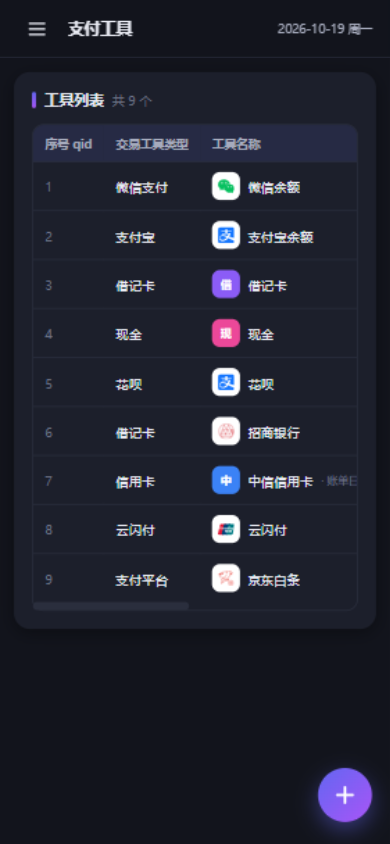
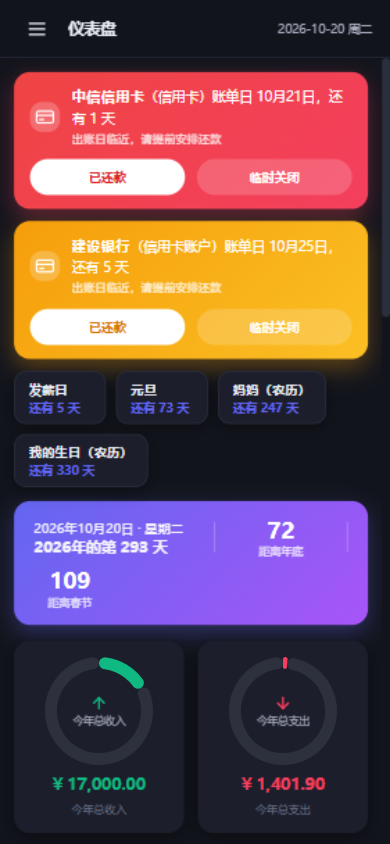

# ModWalletDiary · 钱包日记

<p align="center">
  
</p>

离线个人记账应用：**纯前端 JS 实现，所有 JS 库已下载到本地（`lib/`），无需联网即可运行**。
数据全部 AES 加密后存于浏览器 `localStorage`；既支持浏览器中使用，也支持 HBuilderX 打包为安卓 APK。

## ✨ 特性一览

- 🔐 **密码解锁**：首次设置密码，数据 AES 加密 → Base64 存储；支持修改密码、锁定
- 📊 **仪表盘**：今年第几天 / 距离年底 / 距离春节；收入支出四圆环；信用卡还款双级横幅；重要日子倒计时；彩色时光轴
- ✏️ **我要记账**：收入/支出、两位小数金额、交易账户必选联动、商户可自定义、可编辑下拉
- 🏷️ **款项名目 / 支付工具**：自定义管理，编号 mid/qid 只增不减，防数据错乱
- 💳 **信用卡管理**：账单日 + 卡号后四位；出账日前 **7 天黄色 / 3 天红色**横幅提醒还款
- 💰 **账户管理**：总资产 / 负债双指标，账户间转账（信用卡只能转入=还款）
- 📈 **统计**：3年 / 1年 / 半年 / 3个月，或指定月份、指定周；按名目汇总 + 分布图
- 🎂 **倒计时**：发薪日、生日（**公历/农历**）、喜欢的节日、春节，每项可单独显示/隐藏
- 📱 **移动端适配**：抽屉侧栏、悬浮添加按钮、单选面板防输入法
- 🎨 **37 个彩色品牌 LOGO** 本地内置（微信/支付宝/各银行/京东/美团/银联三色标…），完全离线可用

---

## 界面预览

### 🔒 解锁 / 首次设置

首次打开设置密码（两遍一致），以后每次打开输入密码解锁；数据用该密码 AES 加密保存，忘了密码无法解密。


### 📊 仪表盘（首页）

- **顶部信息条**：今天是今年第几天、距离年底、距离春节（在设置里隐藏春节后不再显示）
- **还款提醒横幅**：信用卡/花呗/借呗类支付工具与信用类账户的账单日临近 **7 天显示黄色、3 天显示红色**横幅；点「已还款」记录本期（下期临近再提醒），点「临时关闭」本次会话隐藏
- **倒计时条**：来自设置页的发薪日、生日（公历/农历）、节日、春节，每项可单独开关
- **四个圆环**：今年总收入/总支出、本月总收入/总支出
- **时光轴**：按日分组、可下滑加载，每笔带支付工具彩色 LOGO，并按 `支付工具(账户类型)` 显示——余额/零钱类如 `微信支付(零钱)`，银行卡类如 `支付宝(招商银行借记卡-6688)`


### ✏️ 我要记账

账单字段：`wid` 序号、`wtime` 日期时间、`wyear/wmon/wday` 年月日、`Wmoney` 金额（两位小数）、`wtype` 记账类型（收入 1 / 支出 2）、`wname` 款项名目、`wtool` 支付工具、`wacct` 交易账户、`wqtype` 交易路径（线上 1 / 线下 2）、`wpayname` 商户名称、`wnote` 备注。

- **交易账户为原生下拉、必选**（从账户管理筛选），保存后对应账户可用资金自动 **收入 + / 支出 −**，编辑/删除账单自动冲销重算
- 款项名目 / 支付工具 / 商户名称为**可编辑下拉**：**单击**弹出选项面板选择（手机上不弹输入法），**双击**才进入输入编辑；输入新名目/新工具保存时自动创建
- 商户名称预置超市/路边摊/淘宝/拼多多/饭店/水果店，支持自定义；常见平台自动匹配彩色 LOGO


### 🏷️ 款项名目

支持自定义名称、增加、重命名、隐藏（可恢复）；**序号 mid 只正向增加不复用**，防止历史数据错乱；每个名目彩色图标 + 使用笔数统计。


### 💳 支付工具

- **工具类型排第一位**：微信支付 / 支付宝 / 抖音支付 / 云闪付 / 翼支付 / 支付平台 / 借记卡 / 银行卡 / 信用卡 / 花呗 / 借呗 / 现金 / 自定义
- 类型为**信用卡 / 花呗 / 借呗**时必填**账单日**（每月几号出账，1-31）；类型为**银行卡 / 借记卡 / 信用卡**时必填**卡号后四位**
- 序号 qid 只正向增加不复用；隐藏（删除）可恢复，历史账单不受影响
- 常见支付工具自动匹配彩色 LOGO，自定义工具显示随机颜色 + 首字


> 📱 手机端：新增支付工具卡片默认隐藏，右下角**悬浮「+」按钮**打开新增弹窗



### 💰 账户管理

字段：`accid` 序号、`accname` 账户名称（如支付宝、微信、抖音、快手）、`acctype` 账户类型、`accuid` 账号卡号、`accmny` 可用资金。

- 账户类型：余额、零钱、零钱通、余额宝、数字人民币、现金、借记卡、信用卡、花呗、分付、月付、白条、金条
- **信用卡 / 花呗 / 分付 / 月付 / 白条 / 金条为信用类**：需填写账单日与信用额度，**不计入总资产**；`信用额度 − 可用资金 = 负债` 单独计入负债
- 顶部**总资产 / 负债**双指标条；编辑账户可直接修正可用资金（覆盖自动计算的余额）
- **转账**：任意非信用类账户之间划转；**转入信用类账户 = 还款**（负债随之减少）；弹窗内含全部账户明细与转账后预览


### 📈 统计

按时间范围统计：**3年 / 1年 / 半年 / 3个月** 预设，或**指定月份**、**指定周**；结果含总收入、总支出、结余、笔数，按款项名目汇总支出/收入并列出占比进度条，附支出分布柱状图。


### 🗂️ 管理

- **导出**：将 localStorage 中 WalletDiary 加密数据下载为本地文件（APP 环境写入公共文档目录）
- **导入**：选择本机文件，支持**合并式**（同名名目/工具/账户沿用现有编号、账单去重续号，仍用当前密码保存）与**覆盖式**（完全替换，解锁密码变为文件原密码）两种模式；**文件密码与当前密码不同时自动弹出密码输入框**，验证通过才能导入
- **修改密码**：老密码解密 → 新密码加密回写 → 刷新
- 存储信息卡片实时显示数据规模


### ⚙️ 设置

- 发薪日（每月几号）、我的生日、其他人的生日（可多条）、喜欢的节日、春节日期
- **生日支持公历 / 农历两种历法**（农历自动换算公历倒计时，内置 solarlunar 农历库）
- 每个选项后有**显示/隐藏**按钮，控制仪表盘顶部倒计时是否显示；隐藏春节后信息条「距离春节」一并隐藏


### 📱 移动端

≤768px 自动切换抽屉侧栏 + 遮罩；还款横幅自适应换行布局；支持 H5+ 双击返回退出。



---

## 🚀 快速开始

方式一（推荐）：任意静态服务器

```bash
cd ModWalletDiary
python -m http.server 8080
# 浏览器打开 http://127.0.0.1:8080
```

方式二：直接双击 `index.html`（file:// 协议下品牌图标走内置离线库，不受影响）。

## 🔐 数据与加密

- 存储位置：`localStorage`，键名 **`WalletDiary`**（json 树总命名，其余为分类名：`walletdiary` 账单、`mingmu` 款项名目、`gongju` 支付工具、`accounts` 账户、`shanghu` 商户、`settings` 设置、`meta` 元数据）
- 储存格式：全部数据的 JSON 文本 → **AES（CryptoJS）加密 → Base64** 保存
- 首次打开需设置密码（两遍一致），默认数据用该密码加密后写入；以后每次打开需输入密码解锁
- 修改密码：从 `WalletDiary` 读取密文用老密码解密，再用新密码加密回写，然后刷新页面
- 旧版本数据解锁时自动迁移（补齐账户/设置/账单新字段）

## 🤖 HBuilderX 打包安卓 APK（H5 runtime plus）

1. HBuilderX 新建 5+App 项目或将本目录作为本地 HTML 资源导入（`manifest.json` 已含 `app-plus` 配置）
2. 云打包为安卓 APK
3. 系统返回键：**2 秒内按两次退出**（第一次弹 toast 提示）；顶部自动适配 `safe-area-inset-top`
4. 导出在 APP 环境写入公共文档目录（`plus.io.PUBLIC_DOCUMENTS`）

## 📁 目录结构

```
ModWalletDiary/
├── index.html          入口
├── manifest.json       HBuilderX 5+App 打包配置
├── build-icons.mjs     品牌图标采集脚本（node build-icons.mjs 重新生成）
├── css/style.css       全部样式（含暗色模式自适应）
├── docs/screenshots/   界面截图（README 引用）
├── lib/                本地离线库
│   ├── crypto-js.min.js   AES 加密
│   ├── chart.umd.min.js   Chart.js 图表
│   └── solarlunar.min.js  农历换算（公历/农历生日）
└── js/
    ├── brand-icons.js  品牌图标库（37 个彩色支付/平台/银行 SVG，本地内置）
    ├── icons.js        图标匹配（内置库优先 + CDN 回退 + 随机色回退）
    ├── storage.js      存储层（AES/Base64、增删改查、编号只增不减、余额联动、转账）
    ├── ui.js           弹窗 / Toast / 可编辑下拉（单击选择、双击编辑）
    ├── dashboard.js    仪表盘（圆环 + 时光轴 + 还款横幅 + 倒计时）
    ├── record.js       我要记账
    ├── names.js        款项名目
    ├── tools.js        支付工具
    ├── accounts.js     账户管理（总资产/负债/转账）
    ├── stats.js        统计
    ├── manage.js       管理（导出/导入/改密码）
    ├── settings.js     设置（发薪日/生日/节日/春节）
    └── app.js          入口：解锁 / 路由 / 侧栏 / 双击返回退出
```

## 🎨 图标说明

品牌图标本地内置在 `js/brand-icons.js`（37 个，离线可用），SVG 采集自 Iconify 聚合图集（Simple Icons CC0、Remix Icon Apache-2.0、Arcticons GPL-3.0、Logos MIT），并带各品牌**官方色**渲染为彩色 LOGO（云闪付为官方三色标）。运行时按名称关键词匹配；匹配不到的品牌回退为"随机颜色 + 首字"（哈希取色，稳定）。重新采集：`node build-icons.mjs`。

## ✅ 质量保障

已对全部功能做过浏览器自动化回归测试（10 组、60+ 项断言全部通过）：认证与加密、四页数据校验、余额联动与冲销、编号只增、信用卡账单日双级提醒、转账规则、统计精确性、导入导出双模式与异密码弹窗、修改密码、农历换算等。
