# ModWalletDiary · 钱包日记

<p align="center">
  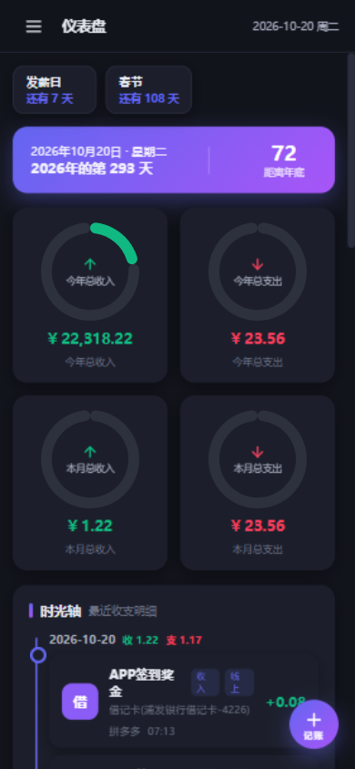
</p>

离线个人记账应用：**纯前端 JS 实现，所有依赖均本地化（`lib/`），无需联网**。
数据 AES 加密后保存在设备本地（localStorage），不上传任何服务器；支持浏览器使用，也支持 HBuilderX 打包为安卓 APK（双击返回退出）。

> **永久免费 · 无需联网 · 开源项目 · 无广告 · 离线应用 · 记账软件**
>
> 开发者：@ModGoSir　联系邮箱：2829969554@qq.com
> 项目地址：<https://gitee.com/wxgshuju/ModWalletDiary>

---

## 📖 目录

- [🔒 解锁 / 首次设置](#-解锁--首次设置)
- [📊 仪表盘](#-仪表盘)
- [💳 还款提醒横幅](#-还款提醒横幅)
- [⚡ 悬浮快捷记账](#-悬浮快捷记账)
- [✏️ 我要记账](#️-我要记账)
- [🏷️ 款项名目](#️-款项名目)
- [💳 支付工具](#-支付工具)
- [💰 账户管理](#-账户管理)
- [📈 统计](#-统计)
- [🗂️ 管理（导入导出 / 改密码）](#️-管理导入导出--改密码)
- [⚙️ 设置](#️-设置)
- [ℹ️ 关于](#ℹ️-关于)
- [快速开始](#-快速开始)
- [数据与加密](#-数据与加密)
- [HBuilderX 打包安卓 APK](#-hbuilderx-打包安卓-apk)
- [目录结构](#-目录结构)
- [图标说明](#-图标说明)
- [质量保障](#-质量保障)

---

## 🔒 解锁 / 首次设置

<p align="center">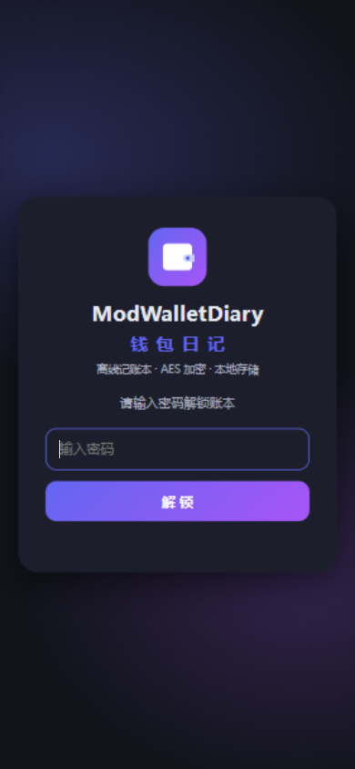</p>

**页面介绍**：主标题 ModWalletDiary，副标题「钱包日记」。首次打开显示「设置密码」——输入两遍一致后创建账本，默认数据用该密码加密后写入 local；以后每次打开输入密码解锁。

**操作说明**
1. 首次使用：输入密码（至少 4 位）→ 再次输入 → 点「创建我的账本」。
2. 日常使用：输入密码 → 点「解锁」（回车也可）。
3. 密码输错会提示「密码错误，请重试」；密码用于加密全部数据，**遗失将无法恢复**，请牢记。
4. 左侧菜单底部「锁定」可随时回到解锁页。

---

## 📊 仪表盘

<p align="center"></p>

**页面介绍**
- **顶部倒计时条**：发薪日、生日（公历/农历）、节日、春节等，来自设置页（生日仅临近 30 天内显示）。
- **日期信息条**：今天是今年第几天；手机端在有春节时只显示「距离年底 / 距离春节」中更近的一个数字，桌面端两者都显示。
- **四个圆环**：今年总收入 / 今年总支出 / 本月总收入 / 本月总支出。
- **时光轴**：按日分组展示最近收支，可下滑并「加载更多」；每笔带支付工具彩色 LOGO，并显示 `支付工具(账户类型)` 或 `支付工具(银行+卡类型-尾号)`。
- 右下角悬浮 **+记账** 按钮（手机端）。

**操作说明**
1. 在时光轴区域上下滑动查看历史明细，点「加载更多 ↓」继续加载。
2. 点右下角圆形 **+** 按钮快速记账（见下一节）。
3. 有信用卡还款提醒时，横幅悬浮在顶部（见还款提醒一节）。

---

## 💳 还款提醒横幅

<p align="center">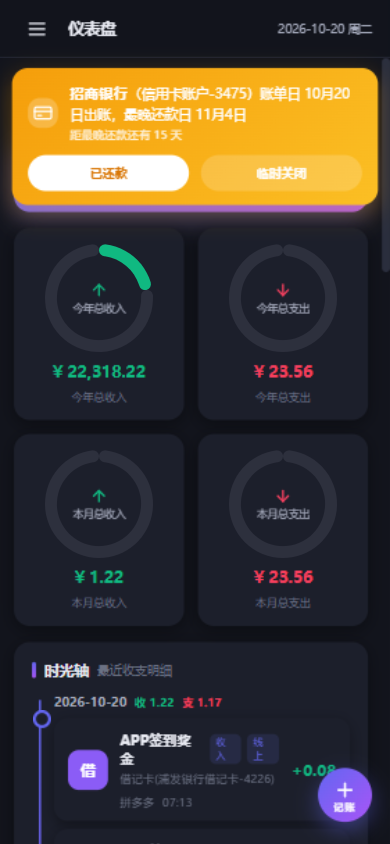</p>

**页面介绍**：信用卡 / 花呗等信用类账户在**账单日的次日**开始提醒（账单日当天银行尚未出账，不提醒），悬浮于页面最上层（仅次于左侧菜单），多条可叠放、不占卡片布局。最晚还款日 = 账单日 + 15 天：
- 刚出账 → **橙黄色**
- 距最晚还款日 ≤7 天 → 颜色逐渐加深偏红
- 今天到期 → 深红
- 超出最晚还款日 → **深红+橙**，提示「已逾期 N 天，请立即还款」
- 横幅显示账户名（类型-卡号尾号）、账单日、最晚还款日和剩余天数。

**操作说明**
1. 出账后自动出现，无需设置（需在账户管理里给信用账户填「账单日」）。
2. 点「**已还款**」：记录本期已还，下个账单日临近时再提醒。
3. 点「**临时关闭**」：本次会话隐藏，刷新后恢复。
4. 不同银行可设置各自的账单日，互不影响。

---

## ⚡ 悬浮快捷记账

<p align="center">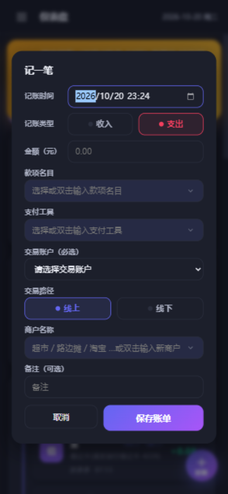</p>

**页面介绍**：仪表盘右下角圆形「+记账」按钮打开「记一笔」悬浮窗，字段与「我要记账」页一致：记账时间、记账类型、金额、款项名目、支付工具、交易账户（必选）、交易路径、商户名称、备注。

**操作说明**
1. 点悬浮 **+** 按钮打开弹窗。
2. 填写金额、名目、工具、账户（默认时间为当前）。
3. 点「**保存账单**」→ 弹窗关闭，**时光轴、圆环、还款提醒、账户余额立即刷新**（无需切页）。
4. 名目/工具/商户为可编辑下拉：**单击**弹出选项选择，**双击**才进入输入模式（新增名称保存时自动创建）。

---

## ✏️ 我要记账

<p align="center">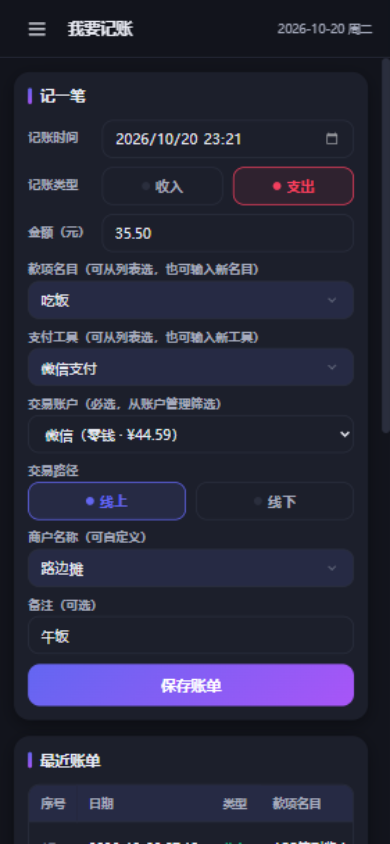</p>

**页面介绍**：完整记账表单 + 最近账单表格（最近 30 条）。字段包括 `wid` 序号、`wtime` 记账时间、`Wmoney` 金额（两位小数）、`wtype` 收入(1)/支出(2)、`wname` 款项名目、`wtool` 支付工具、`wacct` 交易账户、`wqtype` 线上(1)/线下(2)、`wpayname` 商户、`wnote` 备注。

**操作说明**
1. 选择日期时间与收入/支出，输入金额。
2. 款项名目、支付工具：**单击选择**已有项，或**双击**输入新名称（保存时自动创建）。
3. **交易账户必选**（原生下拉，银行卡类显示卡号后四位）；保存后对应账户可用资金自动 **收入 +、支出 −**。
4. 点「保存账单」完成记账；之后的编辑/删除会自动冲销并重算余额。
5. 表格里点 ✏️ 编辑、🗑️ 删除（删除需确认）。

---

## 🏷️ 款项名目

<p align="center">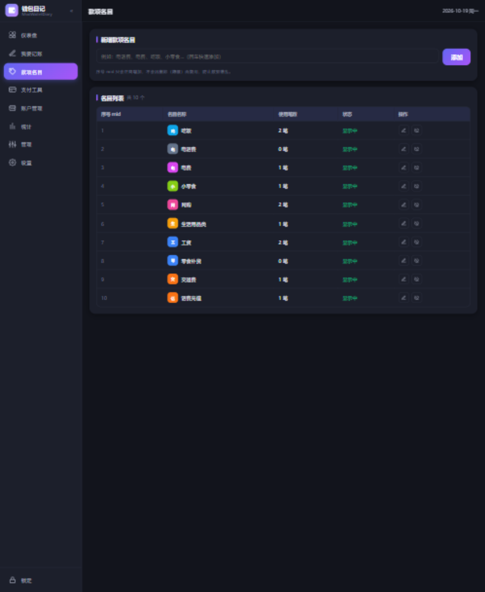</p>

**页面介绍**：管理收支分类（吃饭、电话费、电费、小零食、网购、生活用品类等），显示序号 mid、名称、彩色图标、使用笔数、状态。

**操作说明**
1. 顶部输入名称 → 点「添加」（回车也可），支持任意自定义。
2. 行内 ✏️ 重命名；🚫 隐藏（删除）。
3. 隐藏的名目进入「已隐藏名目」分组，点 👁 恢复。
4. **序号 mid 只正向增加、永不复用**，防止历史数据错乱。

---

## 💳 支付工具

<p align="center">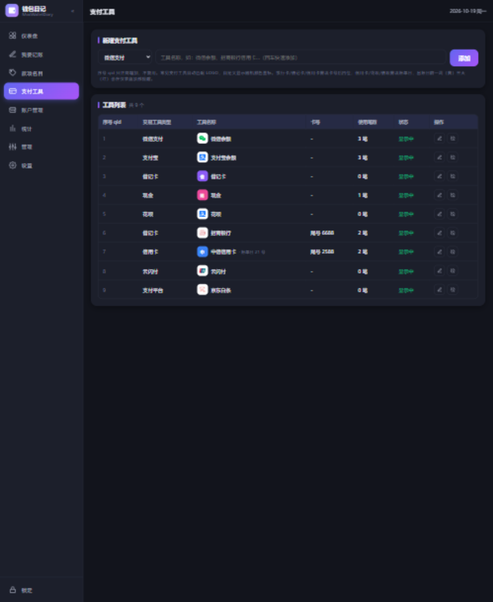</p>

**页面介绍**：管理支付方式（微信支付、支付宝、抖音支付、云闪付、翼支付、支付平台、借记卡、银行卡、信用卡、花呗、借呗、现金等），自动匹配彩色品牌 LOGO，自定义工具显示随机色+首字。手机端表格紧凑：只保留 序号 / 类型 / 名称 / 笔数 / 操作。

**操作说明**
1. **手机端**：顶部新增卡片默认隐藏，点右下角悬浮 **+** 打开新增弹窗；桌面端使用顶部内联表单。
2. 新增时先选**类型**（排第一位），再填工具名称即可；所有类型（含信用卡、花呗、借呗、借记卡等）字段一致，无需填写卡号或账单日。
3. 行内 ✏️ 编辑（类型/名称）；🚫 隐藏、👁 恢复。
4. **序号 qid 只正向增加不复用**，隐藏不影响历史账单。
5. 手机端列表隐藏了卡号列与状态列（信息可在编辑弹窗查看）。

---

## 💰 账户管理

<p align="center">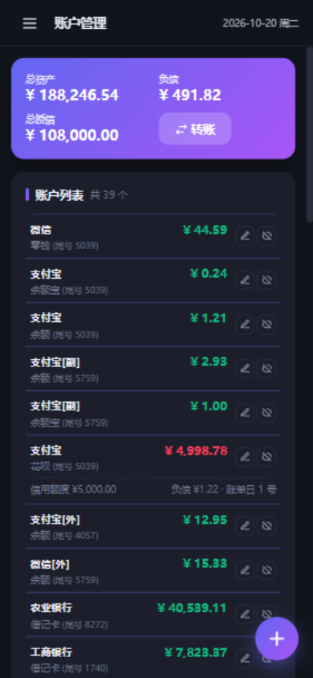</p>

**页面介绍**：管理资金账户（余额、零钱、零钱通、余额宝、数字人民币、现金、借记卡、信用卡、花呗、分付、月付、白条、金条）。顶部三个指标：
- **总资产** = 非信用类账户可用资金之和
- **负债** = 信用类（信用额度 − 可用资金）之和
- **总授信** = 信用类额度之和（**同名账户多张卡只计一次**）；**已隐藏账户不参与**总资产 / 负债 / 总授信计算
- **信用卡同名多卡共享额度**：同一银行（同名）的多张信用卡共用一份信用额度，每张卡负债单独计算，**可用资金 = 共享信用额度 − 该组所有卡负债之和**（所有卡显示同一个可用额度）
- 右侧「转账」按钮。

**操作说明**
1. 新增账户：类型 + 名称 + 账号/卡号 + 初始资金；信用类需填**账单日**和**信用额度**。
2. **账户名称可重复**，但「名称+卡号」组合不能重复。
3. 行内 ✏️ 编辑（可修正可用资金，覆盖自动计算值）；🚫 隐藏、👁 恢复。
4. **转账**：任意非信用类账户 → 任意账户；转入信用类账户即**还款**（负债减少）。弹窗内含全部账户明细和转账后预览；信用类账户只能转入不能转出。
5. **手机端列表**：名称+类型（类型后带卡号尾号，如 `信用卡 (尾号 3475)`），金额大字显示；信用类账户下方一行显示「信用额度 / 负债 / 账单日」，左右两端对齐。

---

## 📈 统计

<p align="center">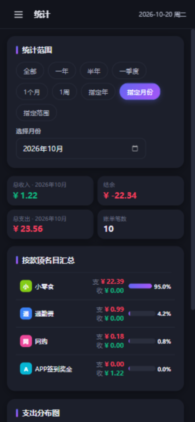</p>

**页面介绍**：9 种时间范围：**全部 / 一年 / 半年 / 一季度 / 1个月 / 1周 / 指定年 / 指定月份 / 指定范围（起始~最终）**。结果含总收入、总支出、结余、账单笔数，按款项名目汇总（支出/收入上下同列、占比进度条），附支出分布柱状图。

**操作说明**
1. 点范围 chip 即可切换；「指定年」输入年份，「指定月份」选月份，「指定范围」选起止日期（颠倒自动交换）。
2. 手机端汇总卡紧凑：总收入/总支出同列上下；名目汇总表为「名目 | 支/收 | 占比」三列，不横向滚动。

---

## 🗂️ 管理（导入导出 / 改密码）

<p align="center">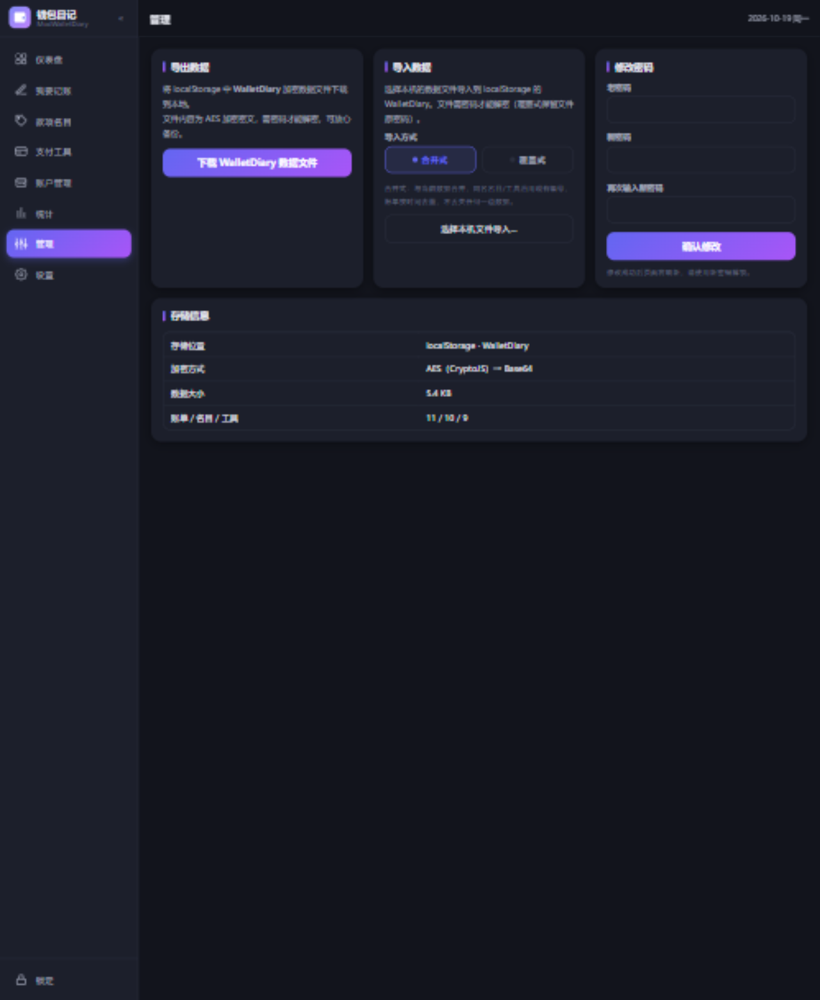</p>

**页面介绍**：导出加密账本、导入本机文件、修改密码，以及存储信息（位置/加密方式/数据大小/数据量）。

**操作说明**
1. **导出**：点「下载 WalletDiary 数据文件」保存加密备份。APP 环境会写出到**应用私有目录**与 **SD 卡 Documents/backups/**（文件名 = 名称_日期_序号.json，当日多次导出自动递增），并**调起系统分享面板**可发出文件。
2. **导入**：先选「**合并式**」（同名名目/工具/账户沿用现有编号，账单去重续号）或「**覆盖式**」（完全替换，解锁密码变为文件原密码），再点「选择本机文件导入…」。
3. **密码不同**时会弹出密码输入框，输入文件密码验证通过才能导入；错误会提示并保持弹窗。
4. **修改密码**：输入老密码 + 两遍新密码 → 确认后刷新页面（新密码生效）。

---

## ⚙️ 设置

<p align="center">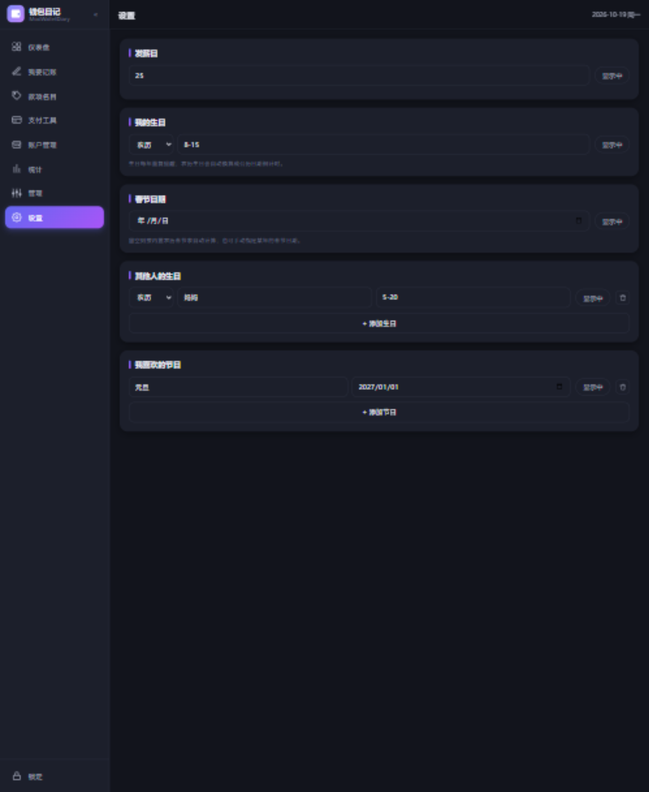</p>

**页面介绍**：显示模式、发薪日、我的生日、春节日期、其他人的生日、我喜欢的节日。每项后可切换「显示中 / 已隐藏」，控制仪表盘倒计时显示。

**操作说明**
1. **显示模式**（最前）：自动（白天 7:00-18:00 浅色、夜晚深色）/ 浅色模式 / 深色模式，点击立即生效并保存。
2. **发薪日**：填每月几号（1-31）。
3. **我的生日 / 其他人生日**：支持**公历 / 农历**切换——农历填「月-日」（如 8-15，日 1-30），自动换算公历倒计时；生日仅在临近 30 天内显示。
4. **春节日期**：留空按内置农历表自动计算，也可手动指定。
5. **节日**：可添加多条（名称+日期）。
6. 点右侧按钮切换显示/隐藏（信息条的「距离春节」不受该按钮影响）。

---

## ℹ️ 关于

<p align="center">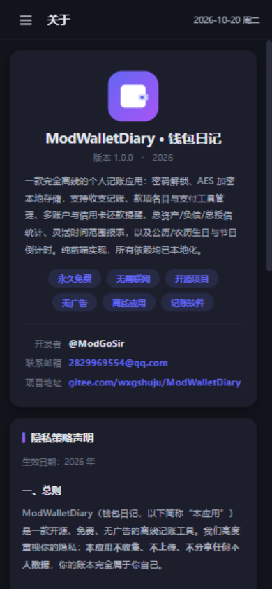</p>

**页面介绍**：应用名称与版本号、软件介绍、六个特性徽章（两行：永久免费/无需联网/开源项目、无广告/离线应用/记账软件）、开发者、联系邮箱、项目地址，以及完整的**隐私策略声明**（数据仅存本机、AES 加密、无服务器、无广告无追踪、权限说明、数据删除与备份、免责声明）。

**操作说明**
1. 点击邮箱可唤起邮件客户端；点击项目地址在浏览器打开 Gitee 仓库。
2. 向下滚动阅读完整隐私策略。

---

## 🚀 快速开始

方式一（推荐）：任意静态服务器

```bash
cd ModWalletDiary
python -m http.server 8080
# 浏览器打开 http://127.0.0.1:8080
```

方式二：直接双击 `index.html`（品牌图标均为本地内置，file:// 下同样可用）。

## 🔐 数据与加密

- 存储位置：`localStorage`，键名 **`WalletDiary`**（json 树根；分类：`walletdiary` 账单、`mingmu` 款项名目、`gongju` 支付工具、`accounts` 账户、`shanghu` 商户、`settings` 设置、`meta` 元数据）
- 储存格式：全部数据 JSON 文本 → **AES（CryptoJS）加密 → Base64**
- 首次打开设置密码；每次打开输入密码解锁；改密码 = 老密码解密 → 新密码加密回写 → 刷新
- 旧版本数据解锁时自动迁移补齐新字段

## 🤖 HBuilderX 打包安卓 APK（H5 runtime plus）

1. HBuilderX 新建 5+App 项目或将本目录作为本地 HTML 资源导入（`manifest.json` 已含 `app-plus` 配置）
2. 云打包为安卓 APK
3. 系统返回键：**2 秒内按两次退出**；顶部适配 `safe-area-inset-top`
4. 导出备份写入应用目录与 SD 卡 `backups/`，并可调起系统分享

## 📁 目录结构

```
ModWalletDiary/
├── index.html          入口
├── about.html          独立关于页（隐私政策 / 服务协议，可单独打开）
├── version.html        启动前协议页（#yinsi / #xieyi 锚点定位）
├── manifest.json       HBuilderX 5+App 打包配置
├── build-icons.mjs     品牌图标采集脚本（node build-icons.mjs）
├── css/style.css       全部样式（浅色/深色自适应）
├── img/logo.svg        应用图标（浏览器标签页 favicon）
├── docs/screenshots/   手机端界面截图（本文引用）
├── lib/                本地离线库
│   ├── crypto-js.min.js   AES 加密
│   ├── chart.umd.min.js   Chart.js 图表
│   └── solarlunar.min.js  农历换算
└── js/
    ├── brand-icons.js  37 个彩色品牌图标（本地内置）
    ├── icons.js        图标匹配（内置库优先 + CDN 回退 + 随机色回退）
    ├── svg-icons.js    界面线性图标（侧栏 / 操作按钮 / 悬浮按钮）
    ├── storage.js      存储层（AES/Base64、增删改查、编号只增、余额联动、转账）
    ├── ui.js           弹窗 / Toast / 可编辑下拉 / 显示模式
    ├── about-content.js 应用介绍 + 隐私政策 + 服务协议正文（三个页面共用一份）
    ├── dashboard.js    仪表盘（圆环 + 时光轴 + 还款横幅 + 倒计时 + 悬浮记账）
    ├── record.js       我要记账
    ├── names.js        款项名目
    ├── tools.js        支付工具
    ├── accounts.js     账户管理（总资产/负债/总授信/转账）
    ├── stats.js        统计
    ├── manage.js       管理（导出/导入/改密码）
    ├── settings.js     设置
    ├── about.js        应用内「关于」页
    └── app.js          入口：解锁 / 路由 / 侧栏 / 双击返回退出
```

## 🎨 图标说明

品牌图标本地内置在 `js/brand-icons.js`（37 个，离线可用），带各品牌**官方色**（微信绿、支付宝蓝、各大银行色、云闪付三色标等）。匹配不到的品牌回退为「随机颜色 + 首字」。重新采集：`node build-icons.mjs`。

## ✅ 质量保障

已完成全功能自动化回归测试（47 项断言全部通过）：认证与加密、四页数据校验、余额联动与冲销、编号只增、账单日还款提醒、转账与还款规则、总资产/负债/总授信统计、9 种时间范围、导入导出双模式与异密码弹窗、修改密码、农历换算、彩色图标、关于页内容等。
